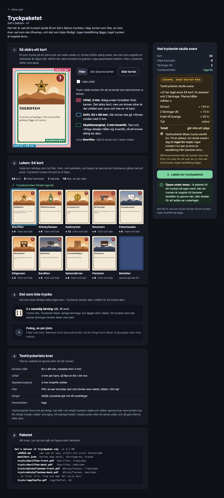

# Tryckpaketet (#1208), prototyp 2026-10-23

Beställaren 2026-10-23 (#1199): designern ska pedagogiskt se det som skulle ha skickats till tryckeriet, och kunna ladda ner det i betan tills en riktig partner finns.
Därefter går tryck via partnern, eller så kostar underlaget (#1209).

Prototypen är `prototyper/index.html`.
Serva mappen över http, inte `file://`, annars laddas inte `proto.css`:

```
cd docs/ux-audits/2026-10-23-tryckpaketet/prototyper && python3 -m http.server 8762 --bind 127.0.0.1
```

Öppna sedan `http://127.0.0.1:8762/index.html?v=B`.
Raden överst växlar variant (A, B, C, eller pilarna), läge (betan eller senare med partner), tryckkontrollen (ren eller ett fel), ytan eller ingången, och bredden.

## Innehållet, lika i alla tre

- **Kortet med utfall, snitt och skyddsmarginal**, ritat på en riktig kortbild och prövbart: «Skär kortet» låter kniven slira upp till 1,4 mm, och «Utan utfall» visar den vita kanten som blir när bakgrunden slutar vid snittet.
- **Leken**: 54 kort i 9 varianter med antal, fram och bak som ett filpar per kort, och baksidan.
- **Det som inte trycks**: två d6 som lagervara (#1140), och poängräknaren som inte följer med.
- **Kraven** ur fake-tryckeriets `requirements()`, i klartext; i dag samma som kortets typ.
- **Vad tryckeriet skulle svara**, märkt «Exempel · inget riktigt pris», med tullen som «okänd» och summan som «går inte att säga», och F2:s «inget EU-tryck».
- **Paketet** som zip-träd, och nedladdningen märkt öppen under betan.

Korten är riktiga: kompilerade med produktens classic-ram, standardtemat (Cinzel och EB Garamond) och `bleed: true`, alltså samma väg som `printExportOf`, och fotograferade i Chromium vid cirka 288 dpi som 69 × 94 mm.
Bilderna på korten är ritade för prototypen.
Inga passmärken, eftersom tryck-PDF:en inte har några och ingen partner i #1199 vill ha dem.

## Varianterna

| | Var den nås | Hur den förklarar |
|---|---|---|
| A | «Tryckpaketet…» i spelets ⋯, bredvid «Exportera…» | En dialog i fem steg: kortet, leken, det som inte trycks, svaret, paketet |
| B | «Tryckpaketet…» i spelets ⋯ och «Se tryckpaketet ›» i Fysisk kontroll | En egen sida i ett svep, med en följesedel bredvid som står kvar |
| C | «Som tryckeriet får det» bland Visning på kortväggen | Väggen med utfall och antal på varje kort, och paketet i en sidopanel |



Fler bilder i [`bilder/`](bilder/).

## Bygget (#1208)

Beställaren valde B 2026-10-23.
Skärmdumparna i [`bygget/`](bygget/) är den byggda sidan i den byggda stacken, med Sal's Saloon och Testtryckeriet, vid 1024, 1280 och 1440 px och på telefon (375).
`fel-*` visar ett spel vars baksida slutar vid snittet, så att tryckkontrollen hittar fel och kortfilerna lämnas ute ur nedladdningen.
