# Brädet på filten och i editorn (2026-10-28, #1473)

Del av PRD #1470, med beställarens beslut 2026-10-28: brädet ligger fast där setupen lade det, de första bräden är ett huvudbräde i några mått och spelarbräden per plats, C2 står kvar (telefonen flyttar till zoner), och brädets sidor går i tryckpaketet som PDF med utfall.

Prototypen är `prototyper/index.html`.
Servera den över http (`python3 -m http.server 8731 --directory prototyper`) och växla med raden överst; ← → byter variant.
Adressen bär läget: `?v=A|B|C&yta=tv1920|tv1280|bord1280|telefon|bordflik|ytan|produkt&platser=4|8&brade=kvadrat|rektangel&pb=1|0`.

## Varianterna

- **A — Brädet i filtens mitt (rekommenderad).** Brädet ligger fast mitt på den gröna filten, högarna flyttar ut på var sin sida om det, och spelarbrädet ligger där «Framför» låg, med sina zoner ovanpå. Filten växer bara så mycket brädet och spelarbräden kräver. Brädets yta ritas i en egen flik «Bräde» med Mall:s verktyg, som «Låda» (L91); i Bord är brädet en rad överst i Spelyta, och zonerna ritas på bilden.
- **B — Brädet bredvid filten.** Filten är exakt dagens; brädet och spelarbräden ligger som ett eget ark till höger om den. Brädet och spelarbrädet är nya sidor i Mall, och arket placeras i Bord under en egen rot «Bredvid bordet».
- **C — Brädet är bordet.** Brädets bild ersätter filtens grönt; bordet är brädet plus platsernas kant, spelarbrädet är platsens kant, och högarna ligger på brädet. Ytan designas direkt i Bord, med Mall:s lager i en högerspalt.

Zonerna på brädets bild läses likadant i alla tre: streckad krita med en mörk gloria, och namnet på en mörk platta över kanten, så de syns mot en bild designern valt och inte bara mot filtens grönt.
Produktbilden (#1406) är densamma i alla tre: brädet i 3D med ljus och glans, som viks ihop och vrids.

## Kortets kortsida i vila, px

Räknat av `prototyper/measure.ts` med produktens egna funktioner (`fitScale`, `feltScale`, `handRoom`, `feltWithHands`, `overscanPx`, `feltFor`, `edgeOf`), resultatet i `prototyper/matt.json`.
TV: scenens bredd väljs som `stageWidth` väljer den, och kortet ritas av kamerans inramning inom overscan; modellen ger i dag 58 px vid fyra platser och 46 vid åtta, där det byggda bordet mätte 57 och 45 (K9 2026-10-25).
Bordsläget är `/table` och `/online`:s lutade filt (`feltScale`) i fönstret minus ett huvud på 57 px; i dag 46 respektive 63 px, där K9 mätte 45 och 61.
Vid 390 ritas ingen filt (C2), så telefonens kort påverkas inte av brädet i någon variant.
Brädet är 457 × 457 eller 610 × 457 mm, ett spelarbräde 240 × 150 mm.
**Fetstil** är under K9:s 45 px.

| Platser | Variant | Bräde | TV 1920 × 1080 | TV 1280 × 720 | Bord 1280 × 800 | Bord 1920 × 1080 | Scen vid 1920 |
| --- | --- | --- | --- | --- | --- | --- | --- |
| 4 | i dag | – | 58 | 46 | 46 | 63 | 760 |
| 4 | A | 457² | 58 | 46 | **44** | 61 | 760 |
| 4 | A | 457² + spelarbräden | 58 | 46 | **40** | 55 | 760 |
| 4 | A | 610×457 | 58 | 46 | **44** | 61 | 760 |
| 4 | A | 610×457 + spelarbräden | 53 | **43** | **40** | 55 | 760 |
| 4 | B | 457² | **42** | **28** | **41** | 61 | 552 |
| 4 | B | 457² + spelarbräden | **42** | **28** | **40** | 60 | 528 |
| 4 | B | 610×457 | **41** | **25** | **38** | 57 | 440 |
| 4 | B | 610×457 + spelarbräden | **41** | **25** | **38** | 57 | 440 |
| 4 | C | 457² | 76 | 51 | **44** | 61 | 760 |
| 4 | C | 457² + spelarbräden | 68 | 45 | **39** | 55 | 760 |
| 4 | C | 610×457 | 73 | 51 | **44** | 61 | 760 |
| 4 | C | 610×457 + spelarbräden | 66 | 45 | **39** | 55 | 760 |
| 8 | i dag | – | 46 | **31** | **27** | **38** | 360 |
| 8 | A | alla fyra | 46 | **31** | **27** | **38** | 360 |
| 8 | B | 457² | **37** | **22** | **27** | **38** | 360 |
| 8 | B | 457² + spelarbräden | **36** | **21** | **27** | **38** | 360 |
| 8 | B | 610×457 (± spelarbräden) | **34** | **20** | **27** | **38** | 360 |
| 8 | C | 457² eller 610×457 | **44** | **30** | **26** | **37** | 360 |
| 8 | C | med spelarbräden | **42** | **28** | **25** | **34** | 360 |

Det som läses ur tabellen:
A kostar ingenting på TV:n vid 1920 i något fall utom rektangeln med spelarbräden vid fyra platser (58 → 53), eftersom fyraplatsbordet är breddbundet bredvid scenen och åttaplatsbordets filt redan rymmer brädet.
A kostar i bordsläget vid 1280 × 800: 46 → 44 px med bara brädet och 40 med spelarbräden, eftersom filten blir högre.
B bryter K9 på TV:n i alla fall: bredden bredvid filten var inte fri, scenen tar den sedan 2026-10-25.
C ger större kort än i dag vid fyra platser, men går under golvet vid åtta.

## Bilder

| | |
| --- | --- |
| A, TV 1920, 4 platser | 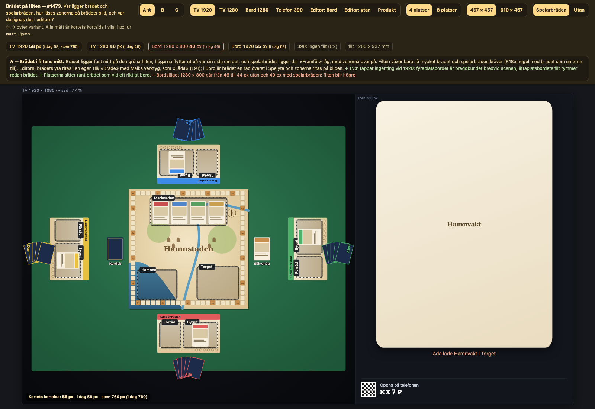 |
| B, TV 1920, 4 platser | 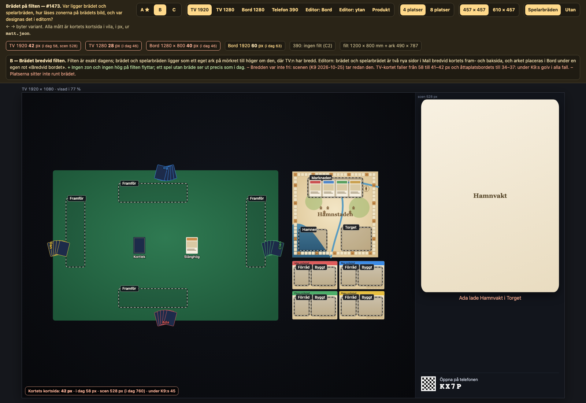 |
| C, TV 1920, 4 platser | 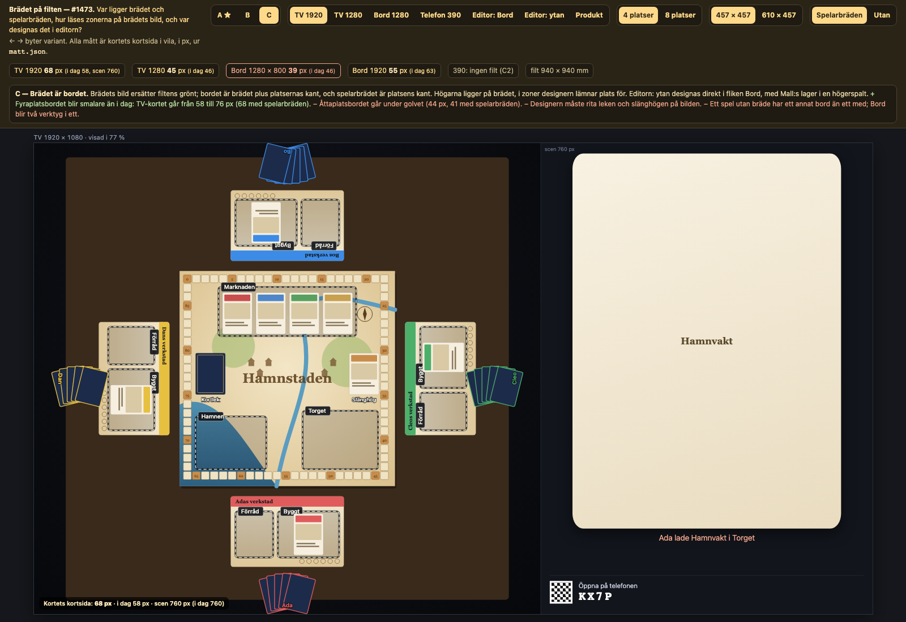 |
| A, TV 1920, 8 platser | 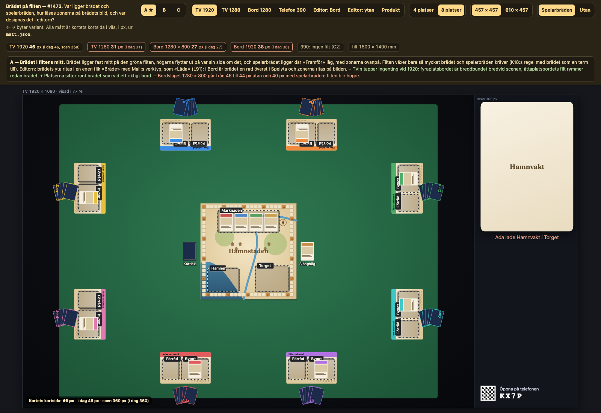 |
| A, bordsläge 1280 | 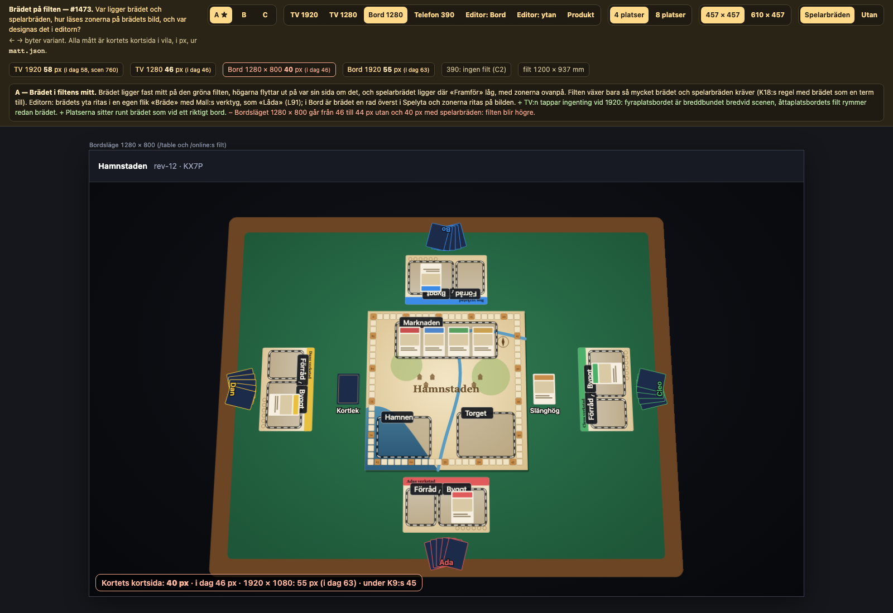 |
| A, editorn: Bord | 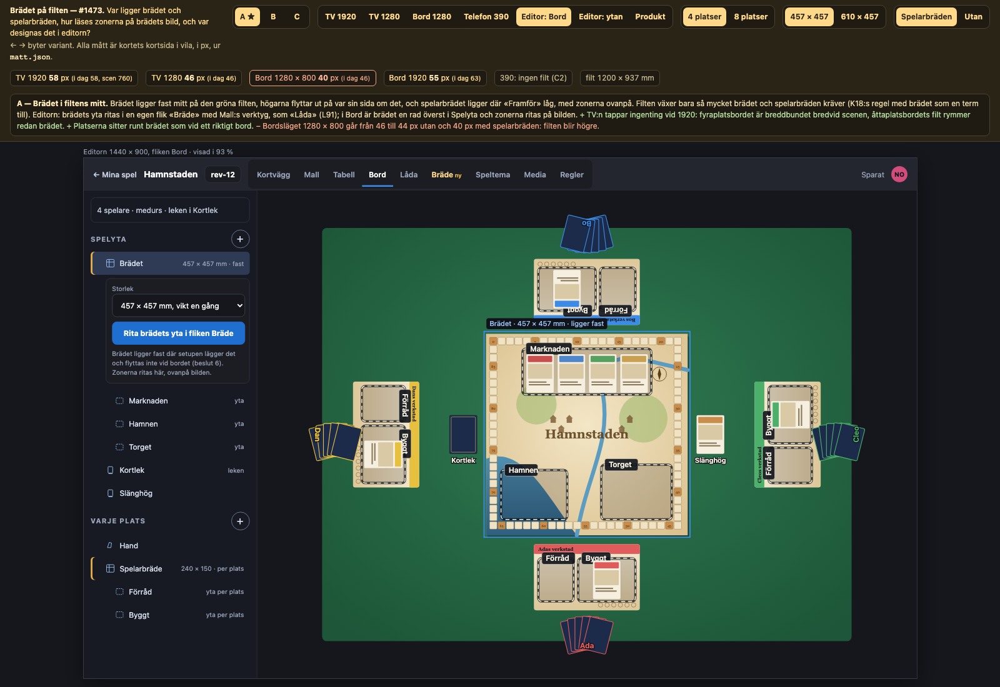 |
| A, editorn: fliken Bräde | 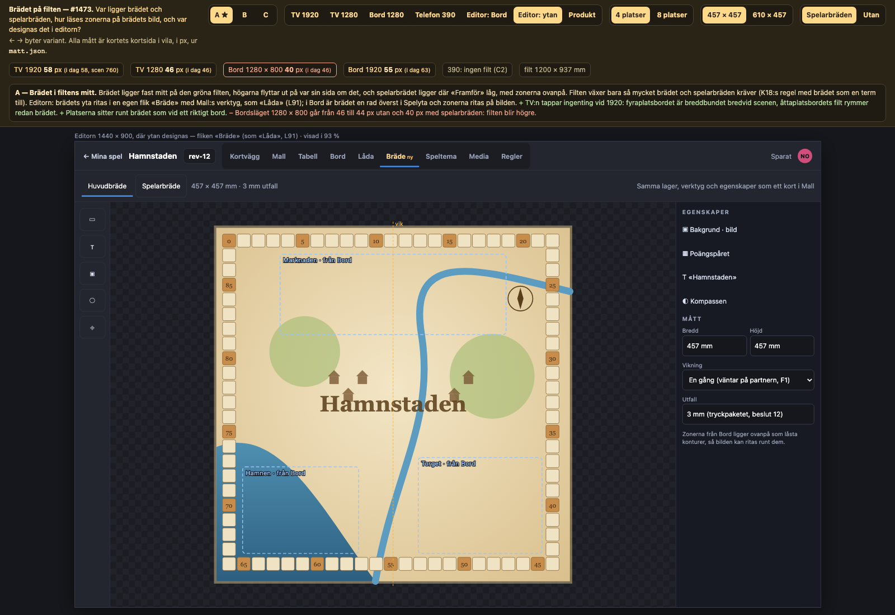 |
| B, editorn: Mall | 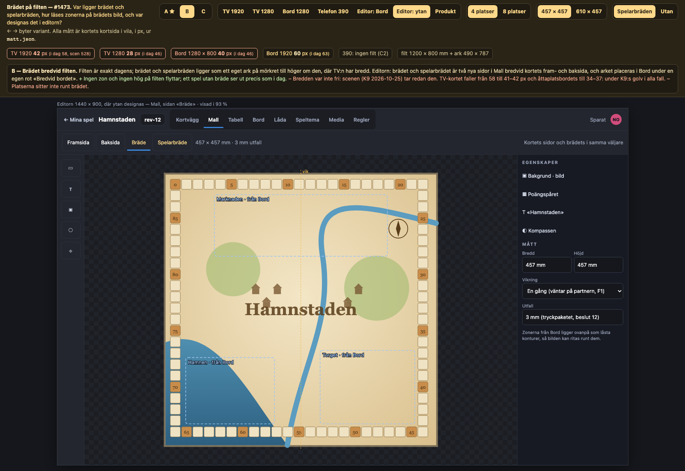 |
| C, editorn: Bord med lager | 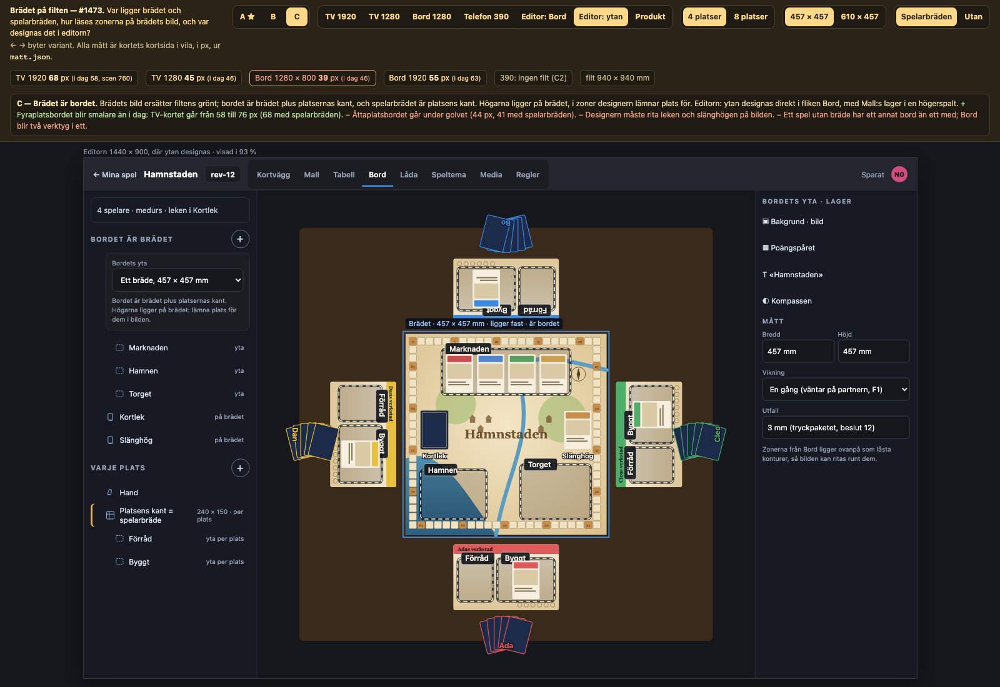 |
| A, telefonen 390 | 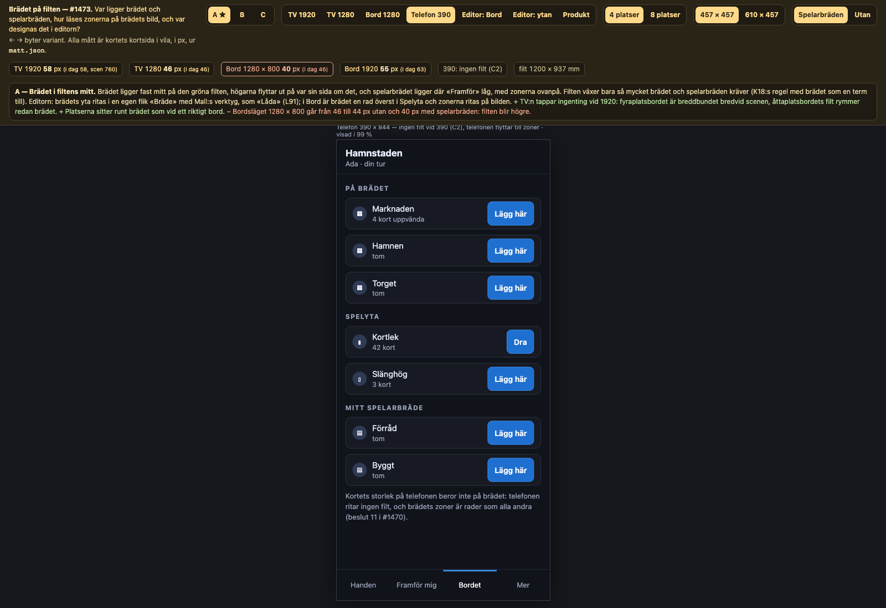 |
| Produktbilden | 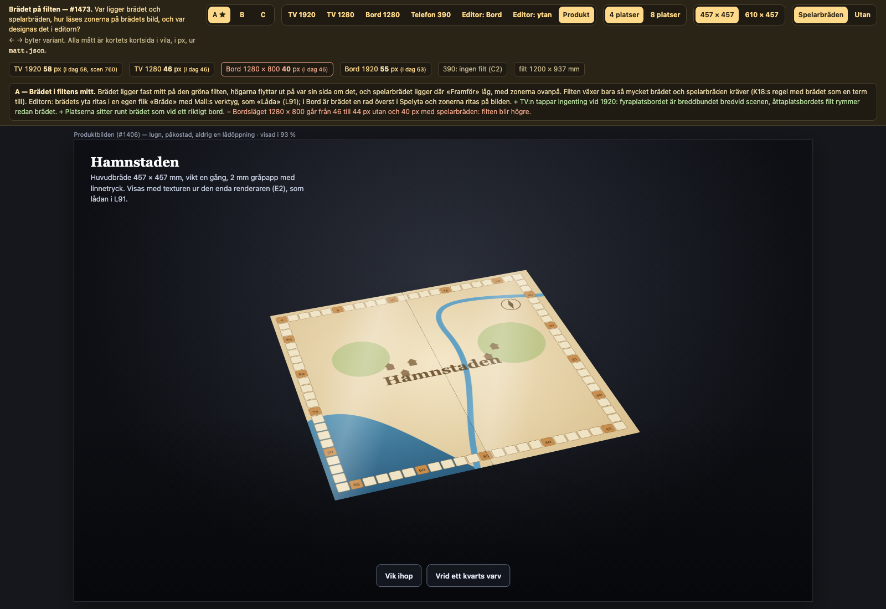 |

Beslutet är inte fattat.
